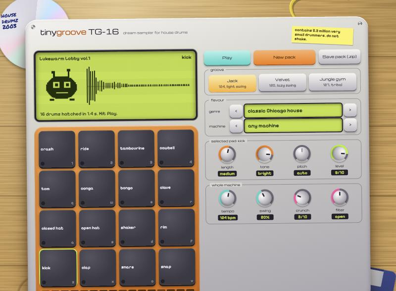

# tinygroove

A drum machine with no samples inside. Every kick, clap and hat is made from scratch in your
browser by a 5-million-parameter neural network, in about a second for a full pack of sixteen.



The model is a student. A large text-to-audio model (Stable Audio 3) played teacher: it made
about 50,000 one-second house drum hits, and a model small enough to ship in a web page learned
to make sounds like them.

## Try it

Play it at **[tinygroove.com](https://tinygroove.com)**, or run it locally:

```bash
python3 demo/serve.py
```

Then open http://localhost:8765. Pads play on click or on `1234 / qwer / asdf / zxcv`; space
starts the groove. It needs a recent Chrome, Edge or other WebGPU browser to be fast, and falls
back to the CPU elsewhere. Nothing leaves your machine.

## How a drum is made

```
noise  ──▶  generator  ──▶  sound code  ──▶  decoder  ──▶  drum
512 numbers   16 steps     32 × 16 numbers    1 pass      1 second
```

Each pad starts as random numbers. The generator nudges them sixteen times toward the request
(drum type, genre, machine, and optionally length, tone and pitch). The decoder turns the result
into audio. Turning a knob keeps a pad's noise and changes only the request, so the sound shifts
but stays the same drum. "New pack" rolls fresh noise for everything.

| | |
|---|---|
| Generator | flow-matching transformer, 4.24M parameters |
| Decoder | spectrogram decoder, 1.02M parameters |
| Download | 22 MB for both |
| Output | 1 s, mono, 44.1 kHz |
| Drum types | 16 |
| Prompt words | 172, including 27 genres and 22 drum machines |
| Training data | 48,741 clips from the teacher |
| Training time | 85 + 19 minutes on one H100 |

## Rebuild it

Each step is one script. You need [uv](https://docs.astral.sh/uv/), a [Modal](https://modal.com)
account for the GPU steps, and a Hugging Face token with access to Stable Audio 3 stored as a
Modal secret named `huggingface`.

Run everything from the repository root; the code is one Python package, `tinygroove`.

| Step | Command | What you get |
|---|---|---|
| 1. Render the teacher's drums | `modal run -m tinygroove.data.modal_gen --n 50000 --out renders/dataset_v4` | 50,004 raw clips (about 55 GPU-minutes) |
| 2. Gate and clean | `uv run --with numpy python -m tinygroove.data.process_dataset renders/dataset_v4` | 48,741 clean one-second clips |
| 3. Train the autoencoder | `modal run -m tinygroove.model.modal_ae --steps 80000 --max-min 85` | `runs/ae_v2/` |
| 4. Train the generator | `modal run -m tinygroove.model.modal_flow` | `runs/flow_v1/` |
| 5. Export for the browser | `uv run --with torch --with numpy --with onnx --with onnxruntime python -m tinygroove.model.export_onnx` | `demo/models/` |

The two trained checkpoints (`runs/ae_v2/ae.pt`, `runs/flow_v1/flow.pt`) are in the repository,
so step 5 works without the first four.

To publish the demo to tinygroove.com (needs `npx wrangler login` once):

```bash
npx wrangler deploy
```

## What is where

```
demo/                  the sampler: one HTML file, the exported models, ONNX Runtime Web
tinygroove/
  data/                the teacher side
    vocab.py             prompt vocabulary, with vocab_catalogue.csv: what each word measurably does
    vocab_screen.py      the experiment that produced the catalogue
    gen_batch.py         prompt planner, and the renderer for a Mac (MLX)
    modal_gen.py         the same renderer on Modal GPUs
    process_dataset.py   the gate: drops clipped, silent and double-hit clips, trims, normalises
  model/               the student side
    ae_model.py          the drum autoencoder (ae_train.py trains it, modal_ae.py runs that on Modal)
    flow_model.py        the generator (flow_train.py, flow_eval.py, modal_flow.py likewise)
    export_onnx.py       PyTorch to ONNX for the browser, checked against PyTorch
runs/                  training outputs; only the two checkpoints above are kept in git
extras/                early helpers: test renders on a Mac, a loop sequencer
wrangler.jsonc         Cloudflare config for tinygroove.com
```

## Known faults

- The cowbells are not good.
- Kicks carry less sub-bass than a real 808.
- Variety within a drum type is about 85% of the teacher's.
- One second of mono is all it knows.

## Thanks

To [Stable Audio 3](https://github.com/Stability-AI/stable-audio-3) for teaching,
[tiny-voca](https://github.com/n4ze3m/tiny-voca) for the idea of a very small student, and
[ONNX Runtime Web](https://onnxruntime.ai) for running it in a tab.

## Licence

MIT. See [LICENSE](LICENSE).
